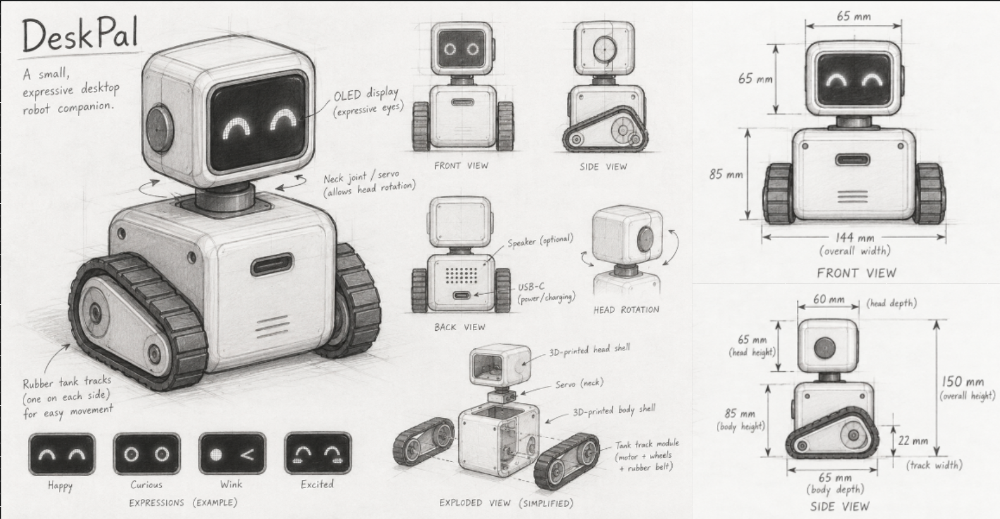

# DeskPal: An Animatronic Desk Companion on Tracks

Assignment 4 in IN5590,
**Group:** Markus Yuki Nishimura (markusyn) & Martin Haugen (martin27)
**Printer:** Isaac
**Topic:** C: Animatronics

---

## 1. Topic and motivation

Our robot is a **desk companion**: a small robot that drives on tracks, lives on a desk or table, and keeps its owner company. Its main job is to show how it "feels". It has a display for a face, and its emotions change with what happens around it. We chose this topic because robots such as Cozmo and EMO show that a small machine with a readable face and believable motion can feel alive, and we want to learn what it takes to build that from scratch: the mechanics, the electronics and the software. A desk is also a demanding place for a robot. It is small, it has edges, and a desk companion that falls off the table is broken and no longer believable. Expression and safety must therefore work together, and both depend on the physical design: where the display, camera and sensors sit, and how low the center of gravity is.

The robot shows six emotions. Each one is linked to an event that the robot can sense:

| Emotion | When the robot shows it |
|---|---|
| Neutral | Idle, nothing happens |
| Happy | It finds its person, or the person comes closer |
| Sad | It loses its person, or is left alone for a while |
| Surprised | Someone appears suddenly, or it is picked up (all edge sensors see no surface at once) |
| Scared | It detects the table edge and backs away |
| Angry | It is blocked: the tracks are driven, but the encoders show no motion |

Five of the six are basic emotions in Ekman's theory (enjoyment, sadness, surprise, fear and anger)[^ekman], which makes them good candidates for faces that people can tell apart. We left out disgust because it has no clear trigger on a desk.

**Optimization task: follow a target.** The robot should turn and drive to keep its person centered in the camera view and at a set distance. The person usually sits or stands *beside* the table, so from the robot's point of view the target is often beyond the edge. Following therefore conflicts with edge safety all the time, and edge safety always wins. We will optimize how well the robot follows (tracking error and how often it loses the target) by tuning the follow controller, the speed limits and the camera settings, and we will measure the result in experiments.

## 2. Goals

The main focus is the design of the physical robot. The goals are listed in priority order. When goals conflict, edge safety comes first, then motor cut-off, then following, then expression.

1. **Physical design (main focus).** Build a compact chassis in CAD with parameters for the key dimensions (motor mounts, track width, display cutout, sensor positions, wall thickness). The chassis holds the display, camera, battery and electronics, with a low center of gravity between the tracks. The edge sensors sit ahead of the tracks by more than the measured stopping distance.
2. **Expression (Must).** Show six emotions that people can tell apart, drawn as animations rather than still images. Pass criterion: in a test with people outside the group, a majority recognize each emotion.
3. **Safety (Must).** Detect the table edge and stop or back away before any part of a track leaves the surface, at every speed the robot can reach. A physical switch cuts motor power.
4. **Mobility (Must).** Drive forward, reverse and turn in place on tracks.
5. **Following, the optimization task (Should).** Follow a person while staying on the table. We measure tracking error and how often the target is lost, and we improve both by tuning. The robot must not fall off the table in any experiment.
6. **Reactions (Should).** The emotion changes with events: target found or lost, edge detected, picked up, blocked.
7. **Extra animatronic motion (Could).** A servo tilts the head, for example to look up at the person.

### Inspiration

- **Anki Cozmo** is a palm-sized robot on two treads with an OLED display as its face. An "emotion engine" drives its expressions, and its animations were designed by Carlos Baena, a former Pixar animator[^cozmo]. Its SDK shows that cliff detection is a reflex in the robot itself, which stops driving at a cliff[^cozmo-sdk]. *What we take:* tracks plus a display face, one emotion state that drives the face, and an edge reflex at the lowest level that no high-level behavior can override.
- **Living.ai EMO** is a commercial desk pet with an animated face and face recognition. It is marketed as moving around the desk "without ever falling off"[^emo]. *What we take:* the desk-companion use case, recognizing its person, and the requirement that falling off the desk must be ruled out.
- **Pololu Zumo 32U4** is a tracked robot smaller than 10 × 10 cm. It has two micro metal gearmotors with encoders and five downward-facing reflectance sensors for line following or edge detection[^zumo]. *What we take:* a proven drive train (micro metal gearmotors with Pololu tracks) and downward sensors placed at the front. The edge of a sumo ring plays the same role as the edge of a table.
- **Animation principles for robots.** Takayama, Dooley and Ju showed that anticipation and reaction make a robot's behavior easier for people to read[^takayama]. Van Breemen argued that robots need principles from character animation, such as slow in and slow out, to be believable[^vanbreemen]. *What we take:* each emotion is an animation with anticipation and easing, not a still image. The robot "looks" before it moves: the eyes turn toward the person before the tracks turn.

## 3. Sketch and scope



*Figure 1: Design sketch of the robot.*

**In scope:** a 3D-printed PLA chassis on two bought tracks; a display face with six animated emotions; four downward distance sensors for edge detection (two at the front, two at the rear); a smart camera that detects and tracks a person; a battery with a fuse and a motor cut-off switch; and, if time allows, a servo that tilts the head.

**Out of scope:** speech and sound, a phone app or cloud connection, a charging dock, driving on surfaces other than a flat table, and climbing over obstacles.

The software has two layers. In the proposed setup, both layers run on one microcontroller with two cores: one core runs the low-level control loop, and the other runs the behavior and the display renderer.

```
edge sensors ──► LOW LEVEL: edge reflex, motor control, watchdog ──► motor driver ──► tracks
                      ▲ commands                │ state / events
camera ────────► HIGH LEVEL: target detection, behavior, emotion state ──► display renderer
```

The low level checks the edge sensors in every loop iteration before it applies any motor command. The high level can only send commands to the low level, so following can never override the edge stop.

## 4. Bill of materials (BOM)

All parts are **proposed** and not yet ordered. The choice of compute architecture is still open. We propose one microcontroller and a smart camera instead of a single-board computer, because it avoids a second computer and a protocol between two boards, which suits a build of about seven weeks.

| # | Component | Proposed part | Function | Qty | Unit (NOK) | Total (NOK) | Supplier | Status |
|---|---|---|---|---|---|---|---|---|
| 1 | Microcontroller | [ESP32-S3-DevKitC-1-N8R8](https://docs.espressif.com/projects/esp-dev-kits/en/latest/esp32s3/esp32-s3-devkitc-1/user_guide_v1.1.html) (dual-core, 240 MHz, 8 MB flash, 8 MB PSRAM) | Control loop, edge reflex, behavior, display renderer | 1 | 239 | 239 | [Electrokit](https://www.electrokit.com/en/esp32-s3-devkitc-utvecklingskort-8mb-pram-8mb) | Proposed |
| 2 | Target sensor | [DFRobot HUSKYLENS 2](https://www.dfrobot.com/huskylens/huskylens2) (face recognition, human detection, object tracking; UART/I2C; 3.3–5 V) | Detect and track the person to follow | 1 | 860 | 860 | [DFRobot](https://www.dfrobot.com/huskylens) | Proposed |
| 3 | Display | [Adafruit 2.0" 320×240 IPS TFT, ST7789](https://www.adafruit.com/product/4311) (SPI, 3.3/5 V) | The robot's face | 1 | 191 | 191 | Adafruit | Proposed |
| 4 | Edge sensors | [Pololu VL53L4CD time-of-flight carrier](https://www.pololu.com/product/3692) (1 mm–1.2 m, up to 100 Hz, I2C) | Detect the table edge (2 front, 2 rear) | 4 | 133 | 532 | Pololu | Proposed |
| 5 | Drive motors | [Pololu 150:1 micro metal gearmotor HPCB 6 V, extended shaft](https://www.pololu.com/product/3076) (220 RPM no load, 1.5 A stall) | Drive the tracks | 2 | 262 | 524 | Pololu | Proposed |
| 6 | Encoders | [Pololu magnetic encoder pair kit, 12 CPR](https://www.pololu.com/product/4761) | Measure track speed; detect a blocked robot | 1 pair | 86 | 86 | Pololu | Proposed |
| 7 | Motor driver | [Pololu TB6612FNG dual motor driver carrier](https://www.pololu.com/product/713) (4.5–13.5 V, 1 A continuous / 3 A peak per channel) | Drive both motors | 1 | 47 | 47 | Pololu | Proposed |
| 8 | Tracks | [Pololu 30T track set](https://www.pololu.com/product/3033) (35 mm sprockets, 14.6 mm wide, about 85 mm between sprockets) | Drive the robot | 1 set | 167 | 167 | Pololu | Proposed |
| 9 | Regulator | [Pololu D36V28F5 5 V step-down regulator](https://www.pololu.com/product/3782) (5.3–50 V in) | 5 V for the microcontroller, camera and display | 1 | 210 | 210 | Pololu | Proposed |
| 10 | Battery | [Xtar 18650 Li-ion, 3300 mAh, with protection circuit](https://www.electrokit.com/en/batteri-li-ion-18650-3.7v-3300mah-med-skyddskrets-xtar) | 2S pack, 7.4 V nominal | 2 | 124 | 248 | Electrokit | Proposed |
| 11 | Battery holder | [2× 18650 holder with cable](https://www.electrokit.com/en/batterihallare-2x18650-sladdanslutning) | Holds the two cells | 1 | 24 | 24 | Electrokit | Proposed |
| 12 | Charger | [Xtar MC2 Plus, 2 × 1 A](https://www.electrokit.com/en/batteriladdare-li-ion-2a-for-2x-18650-xtar-mc2-plus) | Charge the cells outside the robot | 1 | 133 | 133 | Electrokit | Proposed |
| 13 | Fuse | [MINI blade fuse holder with cable, 10 A](https://www.electrokit.com/en/mini-flatsakringshallare-med-kabel-10a) | Protect the battery output | 1 | 28 | 28 | Electrokit | Proposed |
| 14 | Motor cut-off switch | [Rocker switch, 2-pole on-off, Ø20 mm](https://www.electrokit.com/en/vagomkopplare-2-pol-on-off-20mm-svart) | Physical switch that cuts motor power | 1 | 28 | 28 | Electrokit | Proposed |
| 15 | Tilt servo | [MG90S micro servo, metal gears](https://www.electrokit.com/en/mg90s-micro-servo) | Tilt the head (Could goal) | 1 | 76 | 76 | Electrokit | Optional |
| 16 | Filament | PLA | All printed parts | – | – | – | Lab | Available at the lab |
| 17 | Small parts | Wires, connectors, perfboard, M2/M3 screws | Assembly | – | – | – | Lab | Check lab stock |
| | | | | | **Total** | **≈ 3 300** (≈ 3 400 with servo) | | |

**Notes on the BOM**

- Prices were converted with the Norges Bank rates for 9 October 2026 (1 USD = 9.5623 NOK, 1 SEK = 0.9595 NOK) and rounded. USD prices are list prices without VAT. SEK prices are Electrokit prices with Swedish VAT. Shipping, customs and Norwegian VAT are not included.
- The tracks are bought, not printed, because the lab only has PLA filament.
- The motors are rated for 6 V, and a full 2S pack gives 8.4 V. The firmware will cap the motor PWM so that the average voltage stays within the rating. With 220 RPM and 35 mm sprockets, the theoretical top speed is about 0.4 m/s without load. The firmware speed cap will be set from the measured stopping distance.
- The motor stall current (1.5 A) is above the driver's continuous rating (1 A), although below its 3 A peak. The firmware will use the encoders to detect a stall and stop the motor. The same check triggers the "angry" emotion.
- All four edge sensors start with the same I2C address. Their shutdown (XSHUT) pins let us give each sensor its own address at startup. These pins are not 5 V tolerant, which is not a problem with a 3.3 V microcontroller.
- The HUSKYLENS 2 is large for a small robot (70 × 58 × 19 mm, 90 g, 1.5–3 W). If it does not fit the chassis or the power budget, the fallback is the original HUSKYLENS (US$34.90), which also does face recognition and object tracking.
- The protected cells are 68.8 mm long, and the holder is listed for 65 mm cells. The product page also does not say whether the cells are wired in series. We will check both when the parts arrive, or print our own holder.
- We will choose the fuse rating after we measure the robot's current draw.

## 5. Plan

We work in short iterations of about one week. Each iteration follows the same loop: **plan → build → test → evaluate**. What we learn in the test and evaluation feeds into the next iteration. We build the minimum viable product (MVP) first: drive on tracks, stop at the edge, and show emotions. Following and reactions come only after the MVP works on a real table. Hardware is tested in steps: on the bench with the tracks off the ground, then on the floor, then on a table with a barrier, and last on a bare table.

| Iteration | Week (dates) | Main tasks (responsible) | Milestone: done when |
|---|---|---|---|
| I0 | W41 (5–11 Oct) | Deliverable 4A, due 11 Oct (both); choose and order parts (Yuki); set up repository and tools (Martin) | **M0:** Deliverable 4A handed in and parts ordered |
| I1 | W42 (12–18 Oct) | Bring up each component alone on the bench as the parts arrive: microcontroller, display, edge sensors, motors, camera (Yuki); CAD v1 of the chassis from real part dimensions (Martin); first emotion sketches (Martin); prepare the 4B project review (both) | **M1:** Each component works alone on the bench, and CAD v1 is ready |
| I2 | W43 (19–25 Oct) | 4B project review, 19 Oct (both); print chassis v1 in PLA and mount motors and tracks (Martin); motor control with encoders, speed cap and watchdog (Yuki); renderer draws the six faces (Martin) | **M2:** The robot drives forward, drives in reverse and turns in place on tracks |
| I3 | W44 (26 Oct–1 Nov) | Edge stop with four sensors and stopping-distance tests at several speeds (Yuki); animate the six emotions (Martin); integration (both) | **M3 (MVP):** On a real table, the robot drives, stops at the edge at every speed and shows all six emotions |
| I4 | W45 (2–8 Nov) | Person detection and a first follow controller (Yuki); connect the emotions to events (Martin); chassis v2 design from test results (Martin); Project part 1, due 8 Nov (both) | **M4:** The robot follows a person in a basic way, and Project part 1 is handed in |
| I5 | W46 (9–15 Nov) | Optimization experiments on tracking error and target loss, and tuning (Yuki); print chassis v2 (Martin); Project part 2, due 15 Nov (both) | **M5:** The robot follows a person on the table without any edge falls, the experiment data is logged, and Project part 2 is handed in |
| I6 | W47 (16–22 Nov) | Emotion recognition test with people (Martin); add the tilt servo if time allows (Martin); robustness tests on several tables and in different lighting (Yuki) | **M6:** Feature freeze: all Must and Should goals work |
| I7 | W48 (23–29 Nov) | Buffer for fixes; final tuning (Yuki); demo rehearsal, charged batteries and spare parts (both) | **M7:** The robot is ready for the demo |
| Demo | Monday 30 Nov | Public demo, Project part 3 (both) | **M8:** Demo done |

**Main areas of responsibility**

- **Martin:** mechanical design (CAD, 3D printing, tracks, chassis), emotion design and the display renderer, integration lead and demo.
- **Yuki:** electronics and power, low-level firmware (motor control, edge stop, watchdog), target following and the optimization experiments.

**Risks and what we do about them**

| Risk | What we do |
|---|---|
| Parts take one to two weeks to arrive from outside the Nordic countries | Order in I0 and buy from Nordic shops where possible. Start bench work with the parts that arrive first. |
| Following pulls the robot toward the edge | The edge stop lives in the low level and runs before any motor command. Following can only send commands to it. |
| We fall behind the schedule | Drop the Could goals first, then reduce following. The MVP (M3) has priority, and I7 is a buffer week for fixes. |

---

[^ekman]: P. Ekman, "An argument for basic emotions," *Cognition and Emotion*, vol. 6, no. 3–4, pp. 169–200, 1992. [doi:10.1080/02699939208411068](https://doi.org/10.1080/02699939208411068)
[^cozmo]: "Cozmo," *Wikipedia*. <https://en.wikipedia.org/wiki/Cozmo> (accessed 9 October 2026).
[^cozmo-sdk]: Anki, *Cozmo Python SDK*, `robot.py`, methods `is_cliff_detected` and `enable_stop_on_cliff`. <https://github.com/anki/cozmo-python-sdk/blob/master/src/cozmo/robot.py>
[^emo]: Living.ai, "EMO," product page. <https://living.ai/emo/> (accessed 9 October 2026).
[^zumo]: Pololu, "Zumo 32U4 Robot," item #3125. <https://www.pololu.com/product/3125> (accessed 9 October 2026).
[^takayama]: L. Takayama, D. Dooley and W. Ju, "Expressing thought: improving robot readability with animation principles," in *Proc. 6th ACM/IEEE International Conference on Human-Robot Interaction (HRI)*, 2011, pp. 69–76. [doi:10.1145/1957656.1957674](https://doi.org/10.1145/1957656.1957674)
[^vanbreemen]: A. J. N. van Breemen, "Bringing robots to life: Applying principles of animation to robots," in *Proc. Shaping Human-Robot Interaction Workshop, CHI 2004*, Vienna, Austria, 2004.
