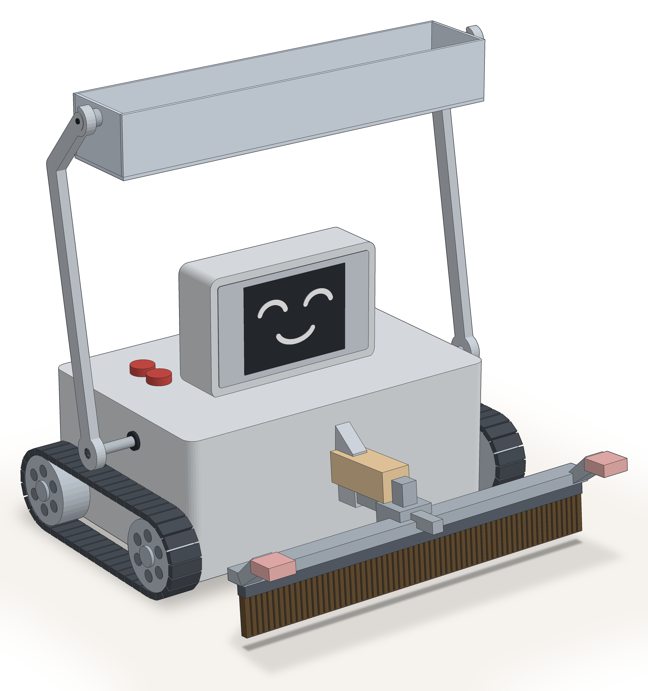
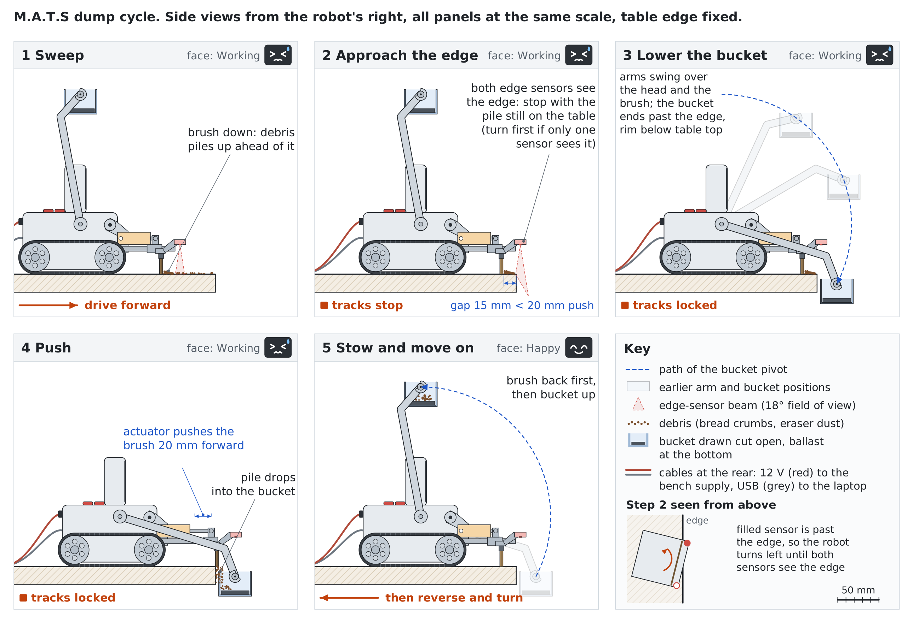
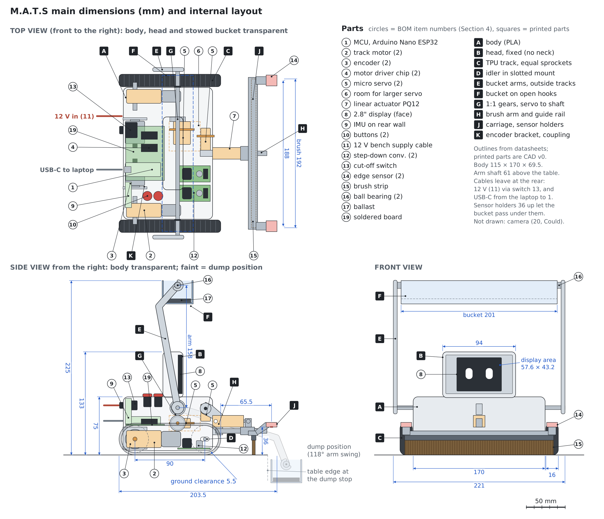

# M.A.T.S: An Animatronic Desk Cleaner on Tracks

Assignment 4 in IN5590,
**Group:** Markus Yuki Nishimura (markusyn) & Martin Haugen (martin27),
**Printer:** Isaac,
**Topic:** C: Animatronics

*Mechanized Assistant for Tabletop Sanitation. Revised draft, 24 October 2026. This version replaces the desk-companion proposal after the feedback on the first draft.*

---

## 1. Topic and motivation

Desks collect crumbs, dust and eraser debris. Wiping them away by hand pushes the debris onto the floor or into the user's lap, and a hand vacuum is loud and must be fetched first. We will build **M.A.T.S** (Mechanized Assistant for Tabletop Sanitation), a small robot that cleans a desk on its own. It drives on tracks and pushes the debris ahead of a brush to the table edge. There it lowers a bucket on two arms over the edge, and the brush pushes the debris into the bucket. When the bucket is full, a person lifts it off, empties it and puts it back.

Two things make M.A.T.S different from existing robots. First, **the table edge is part of the task, not only a hazard.** Robot vacuums use infrared cliff sensors to keep away from ledges such as stairs[^roomba], and desk robots such as Cozmo stop when they detect a cliff[^cozmo-sdk]. M.A.T.S drives to the edge on purpose, because that is where it empties its brush. It must therefore stop close to the edge again and again without ever falling off. Second, **the face shows the work.** Cozmo's face and arm serve play: its arm picks up the cubes that it plays games with[^cozmo]. The face of M.A.T.S tells the user what the robot is doing and what it needs. It strains and sweats while it pushes, it is happy when a load ends up in the bucket, and it is sad when the bucket is full.

We chose this project because it combines a mechanism that must work reliably (two sets of arms, a brush that moves forward and a bucket that stays upright) with a character that people can read. Both depend on the physical design.

## 2. Goals

The main focus is the design of the physical robot. The goals are listed by importance for the project. When goals conflict while the robot runs, edge safety comes first, then the power cut-off, then cleaning, then expression.

1. **Physical design (main focus, Must).** Design the body, the track drive, the brush arm and the bucket arms in parametric CAD, then print and assemble them. The design succeeds when all of these tests pass:
   - **Reach:** the bucket arms move the bucket from its stowed position above the head to a position past the table edge, with the bucket rim below the table top, without touching the edge. Pass: 10 of 10 tries.
   - **Upright bucket:** the bucket carries a full load of test debris from the dump position to the stowed position and back without spilling. Pass: no debris lost in 10 tries.
   - **No tipping:** in the worst pose (bucket lowered past the edge and full, brush pushed forward), both tracks stay flat on the table. Pass: checked in CAD with measured masses, then 10 of 10 tries on the table.
   - **Detachable bucket:** a person removes and reattaches the bucket with one hand and no tools.
   - **Brush contact:** when lowered, the brush touches the table along its full width. When raised, it clears the table.
2. **Safety (Must).**
   - When driving forward, the robot stops before any part of a track leaves the surface, at every speed. Pass: 10 of 10 approaches per speed, both head-on and at 45° to the edge, on three different tables, with no code changes between the tables.
   - The robot reverses only along the path it has just driven, and it turns in place only where its corners stay on the table. Pass: no track leaves the surface during the 10 dump cycles in goal 4.
   - The tracks cannot move while the bucket is lowered or the brush is pushed forward. Pass: drive commands sent in these states are ignored in 10 of 10 tries.
   - If the laptop cable comes loose, all motors stop. Pass: 10 of 10 tries, with the tracks off the ground.
   - A physical switch on the robot cuts the external power to all motors, servos and the linear actuator.
3. **Mobility (Must).** Drive 1 m forward and 1 m back along a taped line, and turn 360° in place, first with the brush raised and then with it lowered. Pass: 5 of 5 runs of each test without stalling and without a track slipping or coming off, ending within 5 cm of the start.
4. **Dump cycle (Must).** At the press of a button, the robot runs one full cycle on its own: lower the brush, drive to the edge, square up to it, stop, lower the bucket, push, stow and back away (Section 3). Pass: 10 cycles in a row on one table, with no fall and no step that gets stuck.
5. **Expression (Must).** Show seven states as animations, not still images (Table 1). Pass: in a test with at least 10 people outside the group, each person picks the state shown from a list of the seven names, and a majority pick the right name for each state.
6. **Collection rate, the optimization task (Should).** Increase the share of debris that ends up in the bucket (Section 3). Pass: we report the rate before and after tuning, and the tuned rate is at least 80 % by mass.
7. **Autonomous cleaning (Should).** The robot cleans a table on its own: it repeats the dump cycle along different edges until it is stopped. Pass: 5 minutes of cleaning on each of three tables, with no fall.
8. **Reactions (Should).** The face changes with the events in Table 1. Pass: each event, triggered by hand, shows the right face within 1 s.
9. **Could.** A camera that finds dirty spots.

### Inspiration

- **WALL-E** is the trash-compacting robot in the 2008 Pixar film of the same name. It moves on treads and shows emotion through its large eyes and simple body movements[^walle]. *What we take:* a robot whose character comes from its work, with emotions shown through both the face and the motion of the body.
- **Robot vacuums** such as the Roomba have infrared cliff sensors underneath that keep them from falling off ledges such as stairs[^roomba]. *What we take:* downward edge sensors as a reflex at the lowest level of the software, which no behavior can override. *What we change:* a vacuum only avoids the edge, while M.A.T.S approaches it on purpose. Its edge sensors therefore sit on the brush, one ahead of each track, where they both guide the approach and run the reflex.
- **Pololu Zumo 32U4** is a tracked robot smaller than 10 × 10 cm. It has two micro metal gearmotors with encoders and five downward-facing reflectance sensors for line following or edge detection[^zumo]. *What we take:* tracks driven by DC gearmotors with encoders, and downward sensors at the front corners. The edge of a sumo ring plays the same role as the edge of a table.
- **Animation principles for robots.** Takayama, Dooley and Ju showed that anticipation and reaction make a robot's behavior easier for people to read[^takayama]. Van Breemen argued that robots need principles from character animation, such as slow in and slow out, to be believable[^vanbreemen]. *What we take:* each state is an animation with anticipation and easing. Before the push, the face braces for the effort, and the arms move with slow in and slow out, so the motion reads as effort rather than as a machine.

## 3. Sketch and scope



*Figure 1: M.A.T.S with the bucket stowed above the head.*



*Figure 2: Side views of the cleaning cycle, steps 1–5.*



*Figure 3: Top, side and front views with the main dimensions and the placement of the internal parts.*

**How M.A.T.S cleans** (Figure 2):

1. **Sweep.** The brush arm lowers the brush onto the table, and the robot drives forward. The debris collects in a pile ahead of the brush.
2. **Approach the edge.** Each track drives forward until the edge sensor ahead of it sees the edge, and then stops. If the robot meets the edge at an angle, one track stops first and the other drives on, so the robot turns until it stands square to the edge. The tracks stop while the pile is still on the table.
3. **Lower the bucket.** The bucket arms swing from above the head, over the brush and down, until the bucket hangs past the edge with its rim below the table top.
4. **Push.** The linear actuator pushes the brush forward along its rail, and the pile drops over the edge into the bucket.
5. **Stow and move on.** The actuator pulls the brush back, and the bucket rises to its place above the head. The robot then backs away along the path it came and turns toward a new strip of the table.

The tracks are locked during steps 3 to 5.

**Main parts** (shown in Figures 1 and 2, labeled in Figure 3):

- **Body and head.** A 3D-printed PLA body. The display, a 2.8-inch color screen, sits in a fixed head on top of the body.
- **Tracks.** Two tracks printed in TPU as closed bands with teeth on the inside. They run on printed PLA sprockets with guide ridges. On each side, a DC gearmotor drives the rear sprocket, and the front sprocket runs free in a slotted mount, so that we can adjust the track tension after printing.
- **Encoders.** Each motor has a second output shaft, which turns an encoder through a printed TPU coupling. Each encoder has its own bracket, because its shaft takes at most 10 N of side load[^e6a2] and must not carry the track tension.
- **Brush arm.** One central arm at the front of the body, raised and lowered by a micro servo. The brush is fixed to the arm at an angle that makes it flat on the table when lowered. The arm lifts the brush only slightly, so the brush tilts only a little when raised. The brush slides on a guide rail at the tip of the arm. A linear actuator with a 20 mm stroke and position feedback pushes it forward and pulls it back[^pq12]. The rail takes the side loads, so the actuator only pushes along its own axis.
- **Bucket arms.** Two arms, one on each side of the body outside the tracks, fixed to a shaft through the middle of the body. One micro servo turns the shaft through a pair of 1:1 gears. The arm hubs and the body leave room for a larger servo, in case the micro servo is too weak. The bucket hangs between the arm tips on two ball bearings, and ballast in its bottom keeps it upright in every arm position. The bucket rests on its pivots in open hooks, so a person can lift it off to empty it.
- **Edge sensors.** Two downward time-of-flight sensors sit at the left and right ends of the brush bracket, one ahead of each track, and ahead of the bristles. They run the safety reflex and guide the approach to the edge. With one sensor ahead of each track, the robot also sees an edge that it meets at an angle. The brush lifts only a few millimeters, while the drop at an edge is the full height of the table, so one threshold works with the brush up or down. If the arm fails and the sensors tilt up, they read a long distance, and the reflex stops the robot.
- **No rear sensors.** The robot reverses only along the path it has just driven, and never farther than the encoders measured on the way forward. Before it turns in place near an edge, it backs away until its corners stay on the table during the turn.
- **Inside the body.** One soldered board holds the microcontroller, the two motor driver chips and the pull-up and pull-down resistors. The body also holds the two step-down converters and the IMU. The motors and encoders sit low at the rear, as a counterweight to the bucket. The power cables and the cut-off switch are at the rear.

**Speed and power.** The gearmotors turn at about 140 RPM without load[^dg01d]. The top speed is this speed times the sprocket circumference: with a 35 mm sprocket, for example, it would be about 0.26 m/s. The sprocket diameter is set in CAD, and the firmware caps the speed so that the robot stops within the distance between the edge sensors and the tracks.

One 12 V bench supply powers all actuators and the encoders through one cable:
- The linear actuator runs directly on 12 V.
- One adjustable step-down converter feeds the track motors. The motor driver chips drop part of the voltage[^l293d], so we set the converter so that the motors get about their suggested 4.5 V at full speed[^dg01d].
- A second converter feeds the servos at 5 V.
- The encoders run on 12 V, connected before the cut-off switch, so they keep counting when the motors are cut. Their outputs are open collector, so pull-up resistors to 3.3 V keep the signals at the microcontroller's logic level[^e6a2].

A USB cable from the laptop powers the microcontroller, the edge sensors and the display, and all grounds are connected.

**Emotions.** M.A.T.S shows seven states. Each one is linked to an event that the robot can sense:

| State | When M.A.T.S shows it |
|---|---|
| Neutral | It waits for the start button, or it drives with the brush raised |
| Working | The brush is down, or a dump cycle is running. The face strains, and drops of sweat run down |
| Happy | It finishes a dump cycle, or the bucket is emptied and put back |
| Sad | The bucket is full and waits to be emptied (counted dump cycles since the last press of the "bucket emptied" button) |
| Surprised | It is picked up: both edge sensors see no surface at once, and the IMU senses the lift |
| Scared | It meets an edge that it did not plan to approach, and the safety reflex stops it |
| Angry | It is blocked: the track motors are driven, but the encoders show no motion |

*Table 1: The seven states and their triggers.*

Five of the seven states are basic emotions in Ekman's theory (enjoyment, sadness, surprise, fear and anger)[^ekman]. Neutral is the rest state, and Working is our own state for effort, which we test together with the others.

**Optimization task: collection rate.** We spread a fixed, weighed amount of test debris (bread crumbs and eraser dust) in a marked strip in front of the robot and run one dump cycle. The collection rate is the mass in the bucket divided by the mass that was spread. We tune the driving speed, the stop gap between the brush and the edge, the brush height, and the length and speed of the push, and we compare the rate before and after tuning. The stop gap is the main trade-off: a larger gap keeps the pile safely on the table, but the 20 mm stroke of the linear actuator must cover it.

**Software.** Both layers run on the two cores of the microcontroller. One core runs the low-level control loop, and the other runs the cleaning behavior and the display renderer. A laptop on USB logs the data for the experiments.

```
edge sensors (2), encoders, ──► LOW LEVEL ───────────────────► driver chip 1 ──► track motors (rear sprockets)
actuator position, IMU          edge reflex, dump interlock, ──► servo signals ──► brush-arm and bucket-arm servos
                                motor, servo and actuator    ──► driver chip 2 ──► linear actuator (brush push)
                                control, watchdog
                                   ▲ commands     │ state / events
buttons ──────────────────► HIGH LEVEL: cleaning behavior, emotion state ──► display renderer
```

The low level checks the edge sensors in every loop iteration before it applies any motor command, and a track may move forward only while the sensor ahead of it sees the table. The low level uses the encoders to keep the robot on its own path when it reverses. It lowers the bucket only when the tracks are stopped and both edge sensors see the edge ahead, and it keeps the tracks locked until the bucket is up and the brush is back. In the dump position, the bucket hangs under the edge sensors, so they see the bucket instead of the floor. The servo does not report its position, so the low level starts the push only when both sensors see the bucket. The high level can only send commands to the low level, so the cleaning behavior can never override the edge stop or the interlock. If the USB cable comes loose, the microcontroller loses power, and pull-down resistors on the driver inputs stop the motors.

**In scope:** a 3D-printed PLA body on two printed TPU tracks, driven at the rear by two DC gearmotors with encoders; two micro servos for the brush arm and the bucket arms; a static brush on one arm, pushed by a linear actuator; a detachable bucket that hangs on bearings; two edge sensors and an IMU; a display face with seven animated states; two buttons; and cable power from a bench supply and the laptop, with a cut-off switch.

**Out of scope:** suction or wet cleaning, emptying the bucket without a person, mapping the table, and batteries. We assume that the table is clear of objects. A camera that finds dirty spots is a Could goal.

## 4. Bill of materials (BOM)

We use the lab's equipment wherever we can. Only two items must be bought, both from RS.

| # | Component | Part | Function | Qty | Source |
|---|---|---|---|---|---|
| 1 | Microcontroller | [Arduino Nano ESP32](https://store.arduino.cc/products/nano-esp32) (ESP32-S3, 3.3 V logic) | Low-level control, behavior and display | 1 | Lab |
| 2 | Track motors | [DAGU DG01D 48:1 hobby gearmotor](https://www.sparkfun.com/hobby-gearmotor-140-rpm-pair.html), output shaft on both sides | Drive the rear sprockets | 2 | Lab |
| 3 | Encoders | Yumo E6A2-CW3C, 200 pulses per turn, open-collector outputs (same as the [Omron E6A2-CW3C](https://www.fa.omron.co.jp/data_pdf/cat/e6a2-c_ds_e_8_2_csm490.pdf)) | Measure the motion of each track | 2 | Lab |
| 4 | Motor drivers | [TI L293DNE](https://www.ti.com/product/L293D), two motor channels per chip | One chip for the track motors, one for the linear actuator | 2 | Lab |
| 5 | Arm servos | [DFRobot SER0006 micro servo](https://www.digikey.com/en/products/detail/dfrobot/SER0006/7597224) | Raise and lower the brush arm and the bucket arms | 2 | Lab |
| 6 | Spare arm servo | Larger hobby servo | Replaces a micro servo that turns out to be too weak | 1 | Lab |
| 7 | Linear actuator | [Actuonix PQ12-100-12-P](https://www.robotshop.com/products/actuonix-pq12-p-linear-actuator-20mm-1001-12v-potentiometer) (20 mm stroke, 12 V, position feedback) | Push the brush forward and pull it back | 1 | Lab |
| 8 | Display | 2.8" SPI TFT module, ILI9341 controller, 240 × 320 pixels (board V1.2) | The face | 1 | Lab |
| 9 | IMU | [SparkFun OpenLog Artemis](https://www.sparkfun.com/sparkfun-openlog-artemis.html) (built-in ICM-20948 IMU), data over its serial TX pin | Detect tilt and pick-up (Should) | 1 | Lab |
| 10 | Buttons | Push buttons | Start and stop; "bucket emptied" | 2 | Lab |
| 11 | Power supply | Bench power supply set to 12 V, with cable | Power for all actuators | 1 | Lab |
| 12 | Step-down converters | Adjustable step-down (buck) converter, model to be confirmed | Motor rail and 5 V servo rail | 2 | Lab |
| 13 | Cut-off switch | Switch in the 12 V cable, mounted on the robot | Cut the power to all actuators | 1 | Lab |
| 14 | Edge sensors | [ST SATEL-VL53L4CD](https://no.rs-online.com/web/p/sensor-development-tools/2410906) (RS 241-0906), VL53L4CD time-of-flight sensor, two boards per kit | Safety reflex and edge approach, one sensor ahead of each track | 1 kit (2 sensors) | Buy: RS |
| 15 | Brush | [RS PRO nylon brush strip](https://no.rs-online.com/web/p/door-seals/3269814) (RS 326-9814), cut to width | The brush | 1 | Buy: RS |
| 16 | Bearings | Ball bearings, size to be measured | Bucket pivots | 2 | Lab |
| 17 | Ballast | Lead or steel weights | Keep the bucket upright | – | Lab |
| 18 | Filament | PLA and TPU | Printed parts; TPU for the tracks and the encoder couplings | – | Lab |
| 19 | Small parts | Solderable board, IC sockets, pull-up and pull-down resistors, wires, connectors, M2/M3 screws | Assembly | – | Lab |
| 20 | Camera (Could) | Raspberry Pi 5 and Raspberry Pi camera | Find dirty spots | 1 | Lab |

When the model of the lab's step-down converters is known, we check it and the motor drivers against the stall currents of the motors and servos. The size of the lab's ball bearings is not yet known. We measure them when we have them, and design the bucket pivots around them.

## 5. Plan

We work in short iterations of about one week. Each iteration follows the same loop: **plan → build → test → evaluate**. What we learn in the test and evaluation feeds into the next iteration. Most of the time goes to CAD, printing and assembly, because the mechanism is the main risk. We build the minimum viable product (MVP) first: drive on tracks, stop at the edge, and run one dump cycle at the press of a button. Autonomous cleaning and the optimization come only after the MVP works on a real table. Hardware is tested in steps: on the bench with the tracks off the ground, then on the floor, then on a table with a barrier, and last on a bare table.

| Iteration | Week (dates) | Main tasks (responsible) | Milestone: done when |
|---|---|---|---|
| I0 | W41–W42 (5–18 Oct) | First proposal and Deliverable 4A, due 11 Oct (both) | **M0:** Done. The concept was changed after the feedback |
| I1 | W43 (19–25 Oct) | Revised concept, sketches and deliverable (both); collect the lab parts and send the order list for the edge sensors and brush to the faculty (Yuki); CAD v0: layout of the main parts and the arm geometry, using measured part sizes (Martin) | **M1:** The revised deliverable is handed in, the lab parts are in hand, and the order list is sent |
| I2 | W44 (26 Oct–1 Nov) | 4B project review, 26 Oct (both); CAD v1 of the body, track drive, brush arm and bucket arms (Martin); test prints: a TPU track section with sprockets, the encoder couplings, the arm hubs on the servos, the brush rail with the linear actuator, and the bucket mount with bearings and ballast (Martin); a bench torque test of the bucket servo with a test arm and the bucket with ballast and a full load (Martin); bring up the motors with encoders and driver chips, the servos, the linear actuator, the display and the IMU data stream on the bench (Yuki); design the faces on the laptop (Martin) | **M2:** CAD v1 is done, and each test print and part works on the bench |
| I3 | W45 (2–8 Nov) | Print and assemble robot v1 (Martin); track control with the encoders, speed cap, watchdog, motor stop on a lost USB cable, edge reflex and the reversing rule (Yuki); Project part 1, due 8 Nov (both) | **M3:** The robot passes the mobility test and stops at the edge on a table, and Project part 1 is handed in |
| I4 | W46 (9–15 Nov) | Arm control, the linear actuator, squaring up to the edge, and the dump cycle with its interlock (Yuki); reach, tipping and servo-torque tests, and CAD v2 from the results (Martin); faces on the display (Martin); Project part 2, due 15 Nov (both) | **M4 (MVP):** On a real table, the robot runs a full dump cycle at the press of a button and never falls off, and Project part 2 is handed in |
| I5 | W47 (16–22 Nov) | Print and assemble v2 (Martin); autonomous cleaning (Yuki); collection-rate experiments and tuning (Yuki); animate the seven states and connect them to events (Martin) | **M5:** Feature freeze: the robot cleans a table on its own, and the experiment data is logged |
| I6 | W48 (23–29 Nov) | Emotion recognition test (Martin); tests on three tables (Yuki); fixes, demo rehearsal and spare parts (both) | **M6:** The robot is ready for the demo |
| Demo | Monday 30 Nov | Public demo, Project part 3 (both) | **M7:** Demo done |

**Main areas of responsibility**

- **Martin:** mechanical design (CAD, 3D printing, assembly of the body, tracks and arms), the emotion design and the display renderer, integration lead and demo.
- **Yuki:** parts, electronics and power, low-level firmware (track motors with encoders, servos, linear actuator, edge reflex, interlock, watchdog), the cleaning behavior and the optimization experiments.

**Risks and what we do about them**

| Risk | What we do |
|---|---|
| An edge sensor arrives late or is damaged, and we have no spare | Send the order in I1, and test the drive and the arms with lab parts until the sensors arrive. Bring up each sensor on the bench before mounting it, and test on a table with a barrier before a bare table. If a sensor fails, reorder at once, and test only with the tracks off the ground until the new one arrives. |
| The printed TPU tracks slip, stretch or come off | Print and test a track section in I2, adjust the tension with the slotted front mounts, and use guide ridges on the sprockets. |
| The robot meets an edge at an angle | One edge sensor sits ahead of each track, each track stops on its own sensor, and we test approaches at 45° in the safety tests. |
| The robot tips forward with the bucket out past the edge | Check the center of gravity in CAD with measured masses, and place the motors and encoders low at the rear. If the IMU is fitted, it also stops the robot when it tilts. |
| A micro servo is too weak for the bucket arms | Check the torque in CAD with measured masses and on the bench in I2, and swap in the larger lab servo, which the arm hubs and the body already fit. A counterweight behind the arm pivot also reduces the load. The servo turns 180°[^ser0006] and the arms swing 118° (Figure 3), so a gear ratio of up to about 1.4:1 instead of 1:1 still covers the swing and gives about 40 % more torque. |
| The bucket arms fall when the servos lose power or signal, for example when the cut-off switch is used or the USB cable comes loose | Test how the servos behave without power and without a signal on the bench in I2, and give the stowed bucket a mechanical rest that holds it up without the servo. |
| A driver chip gets too hot when a track motor stalls | The firmware detects a stall from the encoders and cuts the motor. The fallback for the track motors is an L298N driver module that we already have. |
| The printed sprockets or encoder couplings slip on the plastic motor shafts | Measure the shafts, and print several bore sizes in one test print in I2. |
| The pile falls off the edge before the bucket is in place | The edge sensors sit on a bracket ahead of the bristles, and we tune the stop gap. The push starts only when both edge sensors see the bucket. |
| The 20 mm stroke is too short to push the pile into the bucket | Place the edge sensors so that the stop gap fits within the stroke, and use the encoders to stop accurately. A lever on the rail can lengthen the push. |
| The bucket swings when the debris lands in it | Tune the ballast mass and the friction in the pivots, and add a soft end stop. |
| The microcontroller has too few pins | Use one shutdown pin for both edge sensors, tie the display's chip-select low, and read both buttons on one analog pin. |
| We fall behind the schedule | Drop the Could goals first, then autonomous cleaning, and keep the dump cycle at the press of a button. The MVP (M4) has priority, and I6 has time for fixes. |

---

[^roomba]: "Roomba," *Wikipedia*. <https://en.wikipedia.org/wiki/Roomba> (accessed 21 October 2026).
[^cozmo-sdk]: Anki, *Cozmo Python SDK*, `robot.py`, methods `is_cliff_detected` and `enable_stop_on_cliff`. <https://github.com/anki/cozmo-python-sdk/blob/master/src/cozmo/robot.py>
[^cozmo]: "Cozmo," *Wikipedia*. <https://en.wikipedia.org/wiki/Cozmo> (accessed 21 October 2026).
[^walle]: "WALL-E (character)," *Wikipedia*. <https://en.wikipedia.org/wiki/WALL-E_(character)> (accessed 21 October 2026).
[^zumo]: Pololu, "Zumo 32U4 Robot," item #3125. <https://www.pololu.com/product/3125> (accessed 9 October 2026).
[^takayama]: L. Takayama, D. Dooley and W. Ju, "Expressing thought: improving robot readability with animation principles," in *Proc. 6th ACM/IEEE International Conference on Human-Robot Interaction (HRI)*, 2011, pp. 69–76. [doi:10.1145/1957656.1957674](https://doi.org/10.1145/1957656.1957674)
[^vanbreemen]: A. J. N. van Breemen, "Bringing robots to life: Applying principles of animation to robots," in *Proc. Shaping Human-Robot Interaction Workshop, CHI 2004*, Vienna, Austria, 2004.
[^e6a2]: OMRON, "Incremental 25-mm-dia. Rotary Encoder E6A2-C," datasheet CSM_E6A2-C_DS_E_8_2. <https://www.fa.omron.co.jp/data_pdf/cat/e6a2-c_ds_e_8_2_csm490.pdf>
[^pq12]: Actuonix, "PQ12 Micro Linear Actuators," datasheet. <https://cdn.robotshop.com/media/f/fir/rb-fir-42/pdf/actuonix-pq12-datasheet.pdf> (accessed 22 October 2026).
[^dg01d]: SparkFun, "Hobby Gearmotor - 140 RPM (Pair)," ROB-13302. <https://www.sparkfun.com/hobby-gearmotor-140-rpm-pair.html> (accessed 22 October 2026).
[^ser0006]: DFRobot, "9g 180° Micro Servo for Arduino (1.3kg)," SER0006. <https://www.dfrobot.com/product-255.html> (accessed 23 October 2026).
[^l293d]: Texas Instruments, "L293x Quadruple Half-H Drivers," datasheet SLRS008D. <https://www.ti.com/lit/gpn/l293d> (accessed 22 October 2026).
[^ekman]: P. Ekman, "An argument for basic emotions," *Cognition and Emotion*, vol. 6, no. 3–4, pp. 169–200, 1992. [doi:10.1080/02699939208411068](https://doi.org/10.1080/02699939208411068)
