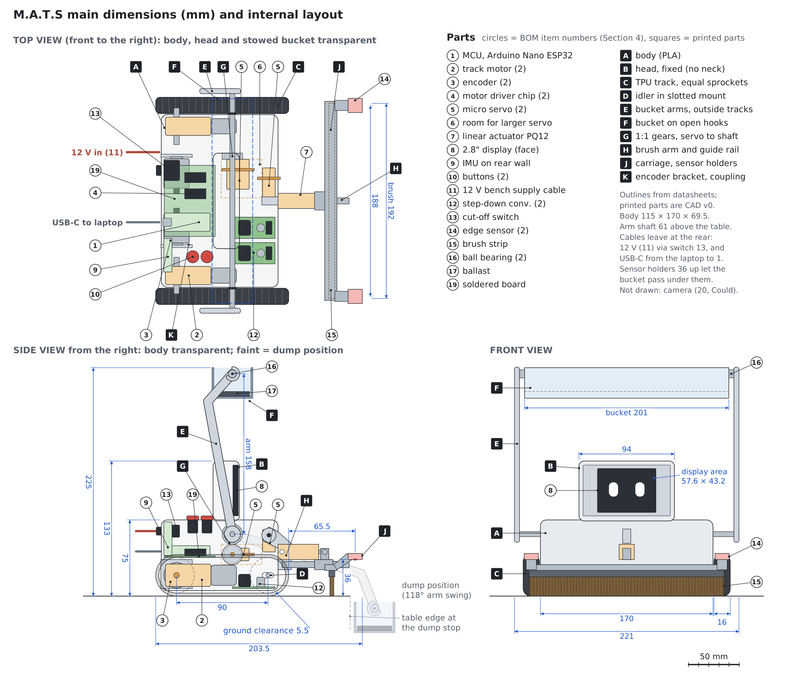
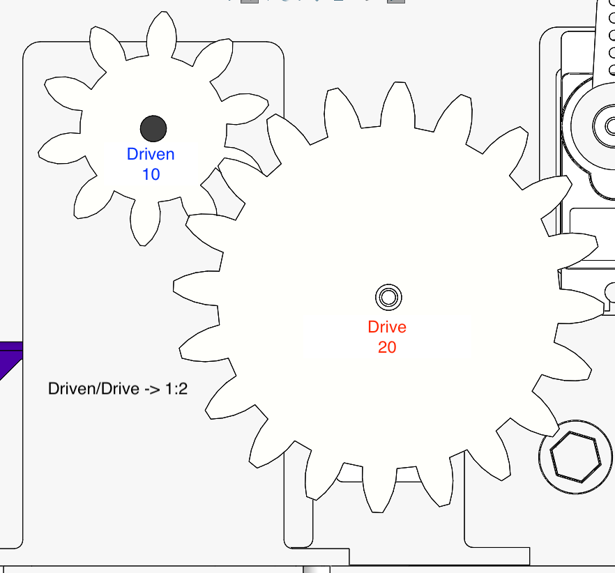
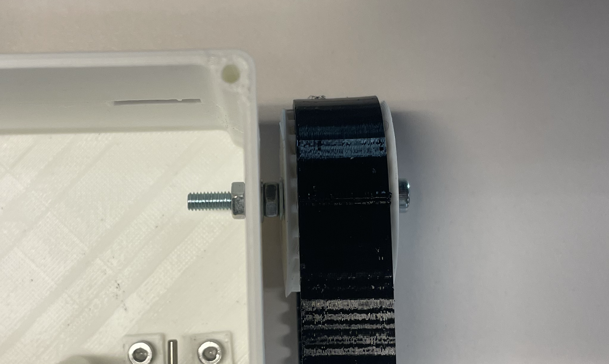
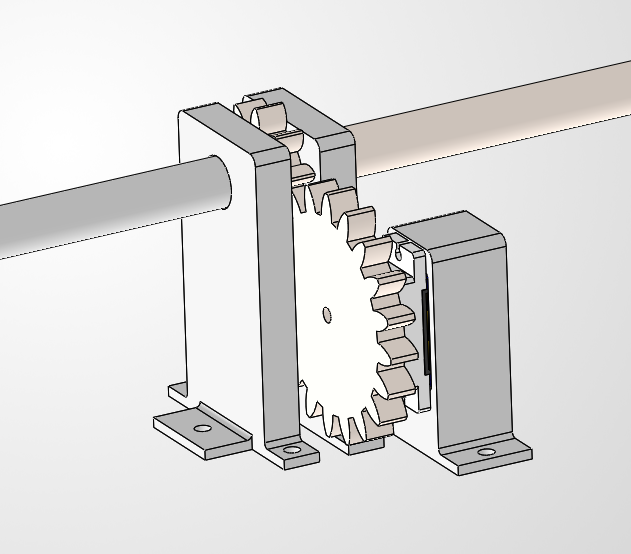
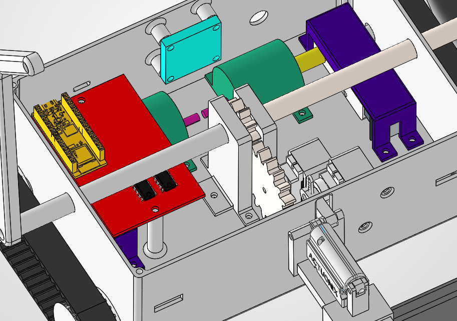
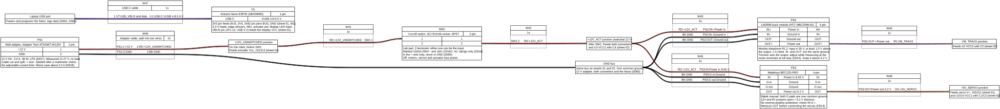

# Project 2 - IN5590
*Project part 2 of 3 in IN5590 by Markus Yuki Nishimura(markusyn) & Martin Haugen(martin27)*
<!-- see assignment text in ./ASSIGNMENT.md -->

## Topic, goals and motivation
<!--Reiterate on the topic, goals and motivation and make a short intro here. Feel free to copy paste from project 1 if applicable. Referance project 1 in footnote-->

### Topic

Desks collect crumbs, dust and eraser debris. Wiping them away by hand pushes the debris onto the floor or into the user's lap, and a hand vacuum is loud and must be fetched first. We will build **M.A.T.S** (Mechanized Assistant for Tabletop Sanitation), a small robot that cleans a desk on its own. It drives on tracks and pushes the debris ahead of a brush to the table edge. There it lowers a bucket on two arms over the edge, and the brush pushes the debris into the bucket. When the bucket is full, a person lifts it off, empties it and puts it back. While doing all this, M.A.T.S also expresses emotions through a display in its head[^project1].

### Inspiration

- **WALL-E** moves on treads and shows emotion through its large eyes and simple body movements[^walle].
- **Robot vacuums** such as the Roomba have infrared cliff sensors underneath that keep them from falling off ledges such as stairs[^roomba].
- **Pololu Zumo 32U4** is a tracked robot smaller than 10 × 10 cm. It has two micro metal gearmotors with encoders and five downward-facing reflectance sensors for line following or edge detection[^zumo].
- **Animation principles for robots.** Takayama, Dooley and Ju showed that anticipation and reaction make a robot's behavior easier for people to read[^takayama]. Van Breemen argued that robots need principles from character animation, such as slow in and slow out, to be believable[^vanbreemen].

### Motivation

We chose this project because it combines a mechanism that must work reliably (two sets of arms, a brush that moves forward and a bucket that stays upright) with a character that people can read. Both depend on the physical design.

**Emotions.** M.A.T.S shows seven states. Each one is linked to an event that the robot can sense:

| State | When M.A.T.S shows it |
|---|---|
| Neutral | It drives with the brush raised |
| Working | The brush is down, or a dump cycle is running. The face strains, and drops of sweat run down |
| Happy | It finishes a dump cycle, or the bucket is emptied and put back |
| Sad | The bucket is full and waits to be emptied |
| Surprised | It is picked up: both edge sensors see no surface at once, and the IMU senses the lift |
| Scared | It meets an edge that it did not plan to approach, and the safety reflex stops it |
| Angry | It is blocked: the track motors are driven, but the encoders show no motion |

*Table 1: The seven states and their triggers.*

Five of the seven states are basic emotions in Ekman's theory (enjoyment, sadness, surprise, fear and anger)[^ekman]. Neutral is the rest state, and Working is our own state for effort, which we test together with the others.

### Goals

**Main goal**: Design a compact and visually appealing robot that will drive around on a table and clean on its own while expressing what work is done through the display without falling off the edge.

#### Sub goals:

1. **Physical design** Design the body, the track drive, the brush arm and the bucket arms in CAD.
   - **Reach:** the bucket arms move the bucket from its stowed position above the head to a position past the table edge, with the bucket rim below the table top.
   - **Upright bucket:** the bucket carries a full load of test debris from the dump position to the stowed position and back without spilling.
   - **No tipping:** in the worst pose (bucket lowered past the edge and full, brush pushed forward), both tracks stay flat on the table.
   - **Detachable bucket:** a person manages to remove and reattach the bucket without it spilling.
   - **Brush contact:** when lowered, the brush touches the table along its full width. When raised, it clears the table.
2. **Safety:**
   - When driving forward, the robot stops before any part of a track leaves the surface.
   - The robot reverses only along the path it has just driven, and it turns in place only where its corners stay on the table.
   - The tracks cannot move while the bucket is lowered or the brush is pushed forward.
   - If the laptop cable comes loose, all motors stop.
   - A physical switch on the robot cuts the external power to all motors, servos and the linear actuator.
3. **Mobility:** Drive 1 m forward and 1 m back along a taped line, and turn 360° in place, first with the brush raised and then with it lowered.
4. **Expression:** Show seven states as animations, not still images (Table 1).


## 1) Optimization

See deliverables for Optimization.

## 2) Firmware/software for the robot/prototype

Setup instructions robot:
```
$ conda create --name <ENV_NAME> --file requirements.txt
$ conda activate <ENV_NAME>
```

Run instructions robot:
```
$ python example.py
```

## 3) Images from testing the robot

[](./poster/main.pdf)

[](./poster/main.pdf)

## 4) Poster

Read more on my poster about the robot [here](./poster/main.pdf). For information on
CAD files, go to [this repo](https://github.uio.no/martin27/in5590_project1).

<!-- Replace `(link to project 1)` with link to *your* assignment 1.-->

## 5) Prototyping process

We worked in iterations of plan, build, test and evaluate. After each print, we fitted the parts, noted what had to change, and fixed it in CAD before the next print. Below are five iterations that were crucial for reaching the goals.

### Iteration 1: A large servo gear and a small rod gear for the bucket arms

- **Task/milestone:** One micro servo turns the rod that carries both bucket arms, through a pair of spur gears that fits inside the body.
- **Requirements:**
    - The servo gear fits on the servo.
    - Both gears fit inside the body.
    - The arms swing the full 118° from the stowed position above the head to a position past the table edge.
- **Implementation:** Our project plan used a pair of 1:1 gears between the servo and the rod (Figure 1, part G).
- **Testing:** A test showed that a small gear did not fit on the servo, so the servo gear had to be larger. With a 1:1 ratio, the rod gear would be just as large and would not fit inside the body.
- **Evaluation:** We kept the large servo gear (20 teeth) and reduced the rod gear to 10 teeth (Figure 2). The rod now turns twice as far as the servo, so the 118° swing needs only 59° of the servo's 180°. In return, the rod gets at most half of the servo's torque, and each degree of the servo moves the arms 2°. This is the opposite of the fallback in our plan, which was a gear ratio of up to 1.4:1 for more torque.
- **Plan:**
    - Test the bucket servo's torque on the bench with the bucket, the ballast and a full load, since the gears halve the torque.
    - If the micro servo is too weak, swap in the larger lab servo. The arm hubs and the body already fit it.



*Figure 1: The layout from our project plan, with 1:1 gears between the servo and the rod (part G).*



*Figure 2: The 20-tooth servo gear and the 10-tooth rod gear in the robot.*

### Iteration 2: M4 screws instead of printed idler screws

- **Task/milestone:** Mount the front (idler) sprocket of each track on the body, so that the track can be put on and tensioned.
- **Requirements:**
    - The idler sprocket turns freely on its axle.
    - The axle holds the sprocket against the pull of the track.
    - The track is easy to put on and take off.
- **Implementation:** The first version used a printed PLA screw as the axle (100 % infill, 0.2 mm layers).
- **Testing:** In the first print, the printed screw was slightly too large, and the hole in the idler sprocket was too small.
- **Evaluation:** Instead of printing a new screw with new tolerances, we used a standard M4 screw with nuts (Figure 3). The idler sprocket we had already printed fits on the M4 screw, so it did not need a reprint. A steel screw is stronger than a printed thread, and the track is easier to mount.
- **Plan:**
    - Check the track tension in the mobility test: 1 m forward and back, and a 360° turn in place.



*Figure 3: An M4 screw through the body wall is the axle of the idler sprocket.*

### Iteration 3: Rod mounts that keep the bucket-arm gears in mesh

- **Task/milestone:** Keep the gears from Iteration 1 in mesh, and the bucket arms straight on the rod, during the full swing.
- **Requirements:**
    - The servo gear and the rod gear stay in mesh over the full 118° swing of the arms.
    - Both arms sit straight on the rod, so the bucket hangs level between them.
- **Implementation:** In the first version, only the holes in the body walls held the rod. The servo sat in its own mount next to the rod gear.
- **Testing:** When we fitted the printed parts in the body, the gears could jump out of mesh. The holes in the bucket arms were also too tight, so the arms did not sit straight on the rod.
- **Evaluation:** We added a printed rod mount (PLA, 60 % infill). It is screwed to the body floor and holds the rod right next to its gear (Figures 4 and 5). We widened the holes in the bucket arms after printing. The rod mount was printed and fitted. The gears now stay in mesh when the servo moved the arms with the loaded bucket.
- **Plan:**
    - Test the reach and check for tipping with the full bucket lowered past the table edge.



*Figure 4: The rod mount (left) holds the rod next to its gear, in mesh with the servo gear. The servo sits in its mount (right).*



*Figure 5: The rod mount inside the body.*

### Iteration 4: Power source and cut-off switch

- **Task/milestone:** Power all actuators through one cable, with a physical switch on the robot that cuts the power to all motors, servos and the linear actuator.
- **Requirements:**
    - Cable power and no battery, as the feedback on our first proposal recommended.
    - The supply covers the worst case, with all loads stalled at the same time.
    - The voltage stays below the 13.2 V maximum of the encoders and inside the input range of both step-down converters.
    - The switch carries the worst-case current. The encoders stay powered when it is off, so they keep counting.
- **Implementation:** The first plan was a 12 V lab bench supply with a 2.5 A current limit. An adjustable LM2596 step-down converter feeds the track motors at about 4.5 V. A Mateksys BEC12S-PRO feeds the servos at 5.2 V; it has only fixed outputs, so it cannot feed the motors. The linear actuator runs directly on 12 V, and the laptop USB powers the microcontroller, the edge sensors and the display. We drew every power wire in WireViz (Figure 6).
- **Testing:** We estimated the worst-case load from the datasheets (Table 2), and compared three switches from the lab by their ratings. A 12 V wall adapter was also on hand. We found its + and − wires with a multimeter and measured 12.27 V without load.

| Load | Power from 12 V |
|---|---|
| 2 servos through the BEC | ≈ 11.8 W |
| 2 track motors through the LM2596 | ≈ 11.7 W |
| Linear actuator | ≈ 2.5 W |
| Logic of both L293D chips | ≈ 0.7 W |
| **Total** | **≈ 27 W, about 2.2 A at 12 V** |

*Table 2: Worst-case power with every load stalled at the same time.*

- **Evaluation:**
    - The wall adapter (Adapter Tech ATS036T-W120V: 12 V, 3 A, 36 W) replaced the bench supply. It is rated above the 2.2 A estimate, and 12.27 V is inside all limits. It is marked LPS (limited power source), so its output stays limited even if a fault occurs. This takes over the role of the bench supply's current limit.
    - Of the three switches, the SCI R13-66 rocker has the largest rating (10 A at 250 V AC), about 4–7 times the estimate. It is rated for AC only, so its DC rating is not guaranteed.
    - The motor stall current is not measured yet, so the motor row in Table 2 uses the 600 mA limit of each L293D channel instead.
- **Plan:**
    - Measure the current with a multimeter in the + wire during the first powered tests, together with the stall current of the motors.
    - Check that the BEC gives 5.2 V before connecting the servos. 8 V or 12 V would damage them.
    - Set the LM2596 while measuring at the motor terminals at full speed.

[](./poster/images/03_power.svg)

*Figure 6: Power wiring. It was drawn before Iteration 5, so it still shows the Arduino Nano ESP32.*

### Iteration 5: Arduino Leonardo instead of the Arduino Nano ESP32

- **Task/milestone:** Connect all sensors, motor drivers, servos and the display to one microcontroller.
- **Requirements:**
    - Enough pins for every part: two track motors with encoders, the linear actuator with position feedback, two servos, two edge sensors, the display, the IMU and two buttons.
    - Wire connections that hold while the robot drives and the arms move.
- **Implementation:** We first chose the Arduino Nano ESP32 from the lab, with the two control layers on its two cores. The pin map used all 22 pins (D0–D13 and A0–A7). To make everything fit, we read only one encoder phase per track and read both buttons on one analog pin. We also left the display's reset and MISO pins unconnected and used the serial pins D0 and D1 for the motor drivers.
- **Testing:** When we wired the robot, the Nano did not have enough GPIO pins for our needs, and the wires on the provided pins made a weak connection.
- **Evaluation:** We replaced the Nano with an Arduino Leonardo. **[FILL IN: how the Leonardo solves the pin count and the connection problem, for example how many free pins it has and how the wires are fastened.]**
- **Plan:**
    - Make a new pin map for the Leonardo, and update the wiring sheets and the firmware.
    - Check the logic level of each part against the Leonardo, since the design was made for the 3.3 V logic of the Nano ESP32.
    - Port the bench test firmware to the Leonardo and run the bench tests again.

**[FILL IN: photo of the Leonardo wired in the body, as ./poster/images/leonardo.jpg]**

## 6) Future work

<!-- In one paragraph, describe future work for your prototype. Moreover, describe what you would do different
if you started the process again.
-->


---

[^walle]: "WALL-E (character)," *Wikipedia*. <https://en.wikipedia.org/wiki/WALL-E_(character)> (accessed 21 October 2026).
[^roomba]: "Roomba," *Wikipedia*. <https://en.wikipedia.org/wiki/Roomba> (accessed 21 October 2026).
[^zumo]: Pololu, "Zumo 32U4 Robot," item #3125. <https://www.pololu.com/product/3125> (accessed 9 October 2026).
[^takayama]: L. Takayama, D. Dooley and W. Ju, "Expressing thought: improving robot readability with animation principles," in *Proc. 6th ACM/IEEE International Conference on Human-Robot Interaction (HRI)*, 2011, pp. 69–76. [doi:10.1145/1957656.1957674](https://doi.org/10.1145/1957656.1957674)
[^vanbreemen]: A. J. N. van Breemen, "Bringing robots to life: Applying principles of animation to robots," in *Proc. Shaping Human-Robot Interaction Workshop, CHI 2004*, Vienna, Austria, 2004.
[^project1]: IN5590 Project Part 1, <https://github.uio.no/martin27/in5590_project1>
[^ekman]: P. Ekman, "An argument for basic emotions," *Cognition and Emotion*, vol. 6, no. 3–4, pp. 169–200, 1992. [doi:10.1080/02699939208411068](https://doi.org/10.1080/02699939208411068)
